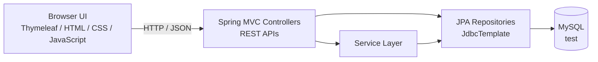
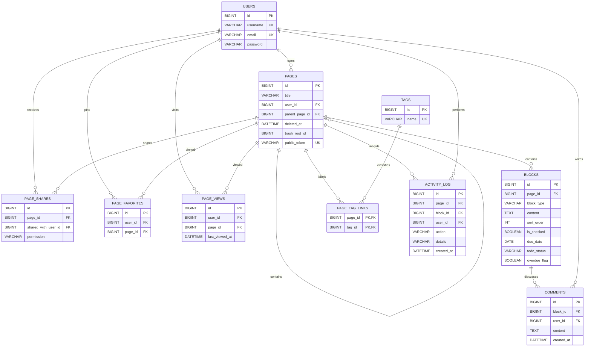

# SyncSpace — A Notion-Style Workspace

SyncSpace is a Notion-inspired course project built to practice full-stack web development, REST API design, relational data modeling, nested page structures, and interactive block editing.

The backend is powered by Spring Boot. The user interface is built with Thymeleaf, HTML, CSS, and vanilla JavaScript. User accounts, pages, content blocks, and page shares are stored in MySQL through Spring Data JPA, Hibernate, JdbcTemplate, and Flyway.

## Screenshots

### Feature Overview — Light Mode


### REST API Documentation — Dark Mode


### Database Structure — Light Mode


## Features

### User Accounts

- Register with a username, email address, and password
- Sign in with an email address and password
- Sign out of the current account
- Keep the user signed in after a page refresh
- Detect duplicate usernames and email addresses during registration
- Update the username after verifying the current password
- Update the email address after verifying the current password
- Change the password after entering the current password
- Manage account details through a tabbed settings dialog

### Page Management

- Create top-level pages
- Create child pages under an existing page
- Build page trees with unlimited nesting levels
- Display all pages in a hierarchical sidebar
- Expand and collapse child-page groups
- Rename a page by editing its main heading
- Display the current hierarchy as breadcrumbs
- Navigate to a parent page through the breadcrumbs
- Move pages and their nested pages to trash, restore them, or permanently delete them
- Convert a content block into a new child page
- Search page titles and block text across owned and shared pages
- Share individual pages with existing users as viewers or editors
- Add tags to pages and filter the sidebar by tag
- Pin owned or shared pages for quick access
- Track the 10 most recently viewed pages on the workspace dashboard
- View backlinks from other accessible pages
- Create meeting notes, weekly plans, and project briefs from templates
- Publish revocable, read-only page links for people without an account
- Review a page activity history with the actor and timestamp
- Import Markdown headings, paragraphs, and checklist items into a page

### Block Editor

- Create a block with the `+` button
- Press Enter to quickly create the next block
- Edit text directly in the page
- Automatically save edited block content
- Delete an empty block with Backspace
- Use the following block types:
  - Text (`p`)
  - Heading 1 (`h1`)
  - To-do (`todo`)
  - Page link (`page`)
- Type `# ` to convert a block into Heading 1
- Type `[] ` to convert a block into a To-do item
- Save the checked state of To-do blocks to the database
- Set due dates and see today's and overdue tasks on the dashboard
- Move tasks between To do, Doing, and Done on a Kanban board
- Add comments to any block
- Drag and drop blocks to rearrange them
- Automatically save the new order after dragging
- Duplicate an existing block
- Open a block context menu with a right click
- Use the context menu to:
  - Turn into Text
  - Turn into Heading 1
  - Turn into To-do
  - Turn into Page
  - Duplicate
  - Delete

### User Interface

- Switch between light and dark themes
- Save the theme preference in the browser
- Use English throughout the interface
- Resize the sidebar by dragging its edge
- Save the sidebar width in the browser
- Navigate through an interactive page tree
- Use modal dialogs for page creation and account settings
- Preserve interface preferences with `localStorage`

## Technology Stack

| Area | Technology |
| --- | --- |
| Language | Java 17 |
| Backend | Spring Boot |
| Web layer | Spring Web MVC and REST APIs |
| Templates | Thymeleaf |
| Frontend | HTML, CSS, and vanilla JavaScript |
| ORM | Spring Data JPA and Hibernate |
| SQL operations | JdbcTemplate |
| Database | MySQL |
| Build tool | Maven and Maven Wrapper |
| Development environment | Apache NetBeans |

## Architecture



## Data Model

Flyway owns the schema in `src/main/resources/db/migration`. New databases are created from the versioned migrations; databases with the original schema are baselined at V1 and upgraded without deleting their data. Hibernate validates the migrated schema at startup.



- `users` stores user accounts.
- `pages` stores pages and uses `parent_page_id` as a self-reference for nested page trees.
- `blocks` stores page content, block types, display order, and To-do state.
- `page_shares` grants an existing user `VIEWER` or `EDITOR` access to a page.
- `tags` and `page_tag_links` model page labels as a many-to-many association.
- `page_favorites` stores per-user pins; the same page can be pinned independently by multiple users.
- `page_views` stores each user's latest visit per page and drives the recent-pages dashboard.
- `blocks.due_date`, `todo_status`, and `overdue_flag` support dated tasks, the Kanban board, and the scheduled overdue refresher.
- `comments` stores block discussions and their author; `activity_log` records page, block, sharing, and comment events.
- `pages.public_token` stores a high-entropy token for an explicitly enabled read-only public page link. Owners can revoke it at any time.
- The scheduled reminder task refreshes overdue flags hourly and once shortly after application startup. The dashboard displays reminders; outbound email delivery is not configured.
- Backlinks are derived from page-link blocks, so they stay in sync as links change.
- Built-in page templates create a new page and its starter blocks in one transaction.
- `deleted_at` and `trash_root_id` track trashed page subtrees without removing their data.
- MySQL FULLTEXT indexes support searches over page titles and block content.
- Flyway migrations in `src/main/resources/db/migration` are the source of truth; Hibernate runs in `validate` mode.
- Block drag-and-drop ordering is saved by updating `sort_order` through JdbcTemplate.

## REST API

Base URL:

```text
http://localhost:8080
```

### User API

| Method | Endpoint | Description |
| --- | --- | --- |
| `POST` | `/api/users/register` | Register a user |
| `POST` | `/api/users/login` | Sign in and create a server-side session |
| `GET` | `/api/users/session` | Get the current session's user |
| `POST` | `/api/users/logout` | End the current session |
| `PUT` | `/api/users/{id}/username` | Update the username |
| `PUT` | `/api/users/{id}/email` | Update the email address |
| `PUT` | `/api/users/{id}/password` | Update the password |

### Page API

| Method | Endpoint | Description |
| --- | --- | --- |
| `POST` | `/api/pages` | Create a top-level page or child page |
| `GET` | `/api/pages/user/{userId}` | Get a user's top-level pages |
| `GET` | `/api/pages/user/{userId}/all` | Get all pages belonging to a user |
| `GET` | `/api/pages/mine/all` | Get owned and shared pages |
| `GET` | `/api/pages/mine/recent` | Get up to 10 recently viewed accessible pages |
| `GET` | `/api/pages/templates` | List built-in page templates |
| `POST` | `/api/pages/from-template` | Create a page and starter blocks from a template |
| `GET` | `/api/pages/tags` | List tags on accessible pages |
| `GET` | `/api/pages/{id}/tags` | List a page's tags |
| `POST` | `/api/pages/{id}/tags` | Add a tag to an editable page |
| `DELETE` | `/api/pages/{id}/tags/{tagId}` | Remove a tag from an editable page |
| `POST` | `/api/pages/{id}/favorite` | Pin an accessible page for the current user |
| `DELETE` | `/api/pages/{id}/favorite` | Unpin a page |
| `GET` | `/api/pages/{id}/backlinks` | List accessible pages linking to a page |
| `GET` | `/api/pages/search?q={query}` | Search accessible page titles and block text |
| `GET` | `/api/pages/trash` | List trashed page roots |
| `POST` | `/api/pages/{id}/restore` | Restore a page and its trashed descendants |
| `DELETE` | `/api/pages/trash/{id}` | Permanently delete a trashed subtree |
| `GET` | `/api/pages/{id}/shares` | List a page owner's shares |
| `POST` | `/api/pages/{id}/shares` | Share with an existing user by email and permission |
| `DELETE` | `/api/pages/{id}/shares/{userId}` | Remove a page share |
| `PUT` | `/api/pages/{id}/title` | Update a page title |
| `DELETE` | `/api/pages/{id}` | Move a page subtree to trash |
| `GET` | `/api/pages/{id}/activity` | Read the latest 100 events on a page |
| `GET` | `/api/pages/{id}/public-link` | Read the current user's public-link settings |
| `POST` | `/api/pages/{id}/public-link` | Create or reuse a public read-only link |
| `DELETE` | `/api/pages/{id}/public-link` | Revoke the public link |
| `POST` | `/api/pages/{id}/import-markdown` | Append blocks parsed from a `.md` upload (max 1 MB) |

All API routes except registration, login, logout, and the explicitly public page endpoint require a server-side login session. Owners have full access; shared viewers can read and comment, and shared editors can edit page content. Public links are read-only and can be revoked by the page owner.
Shares apply to the selected page only; nested pages must be shared separately.

### Block API

| Method | Endpoint | Description |
| --- | --- | --- |
| `POST` | `/api/blocks` | Create a block |
| `GET` | `/api/blocks/page/{pageId}` | Get all blocks on a page |
| `PUT` | `/api/blocks/{id}` | Update block content |
| `PUT` | `/api/blocks/{id}/type` | Change the block type |
| `PUT` | `/api/blocks/{id}/check` | Update a To-do block's checked state |
| `PUT` | `/api/blocks/page/{pageId}/reorder` | Save the block order |
| `DELETE` | `/api/blocks/{id}` | Delete a block |
| `PUT` | `/api/blocks/{id}/due-date` | Set or clear a to-do due date |
| `PUT` | `/api/blocks/{id}/todo-status` | Move a to-do to `todo`, `doing`, or `done` |
| `GET` | `/api/blocks/{id}/comments` | List comments on a block |
| `POST` | `/api/blocks/{id}/comments` | Add a comment to a readable block |
| `DELETE` | `/api/comments/{commentId}` | Delete your comment or a comment on your owned page |

### Dashboard and public pages

| Method | Endpoint | Description |
| --- | --- | --- |
| `GET` | `/api/dashboard/stats` | Get accessible page, block, and to-do counts |
| `GET` | `/api/todos?filter=today` | List accessible, unfinished to-dos due today |
| `GET` | `/api/todos?filter=overdue` | List overdue to-dos whose scheduled flag is set |
| `GET` | `/api/todos/board` | List accessible to-dos with Kanban status and edit permission |
| `GET` | `/api/public/pages/{token}` | Read a page enabled for public viewing |
| `GET` | `/public/{token}` | Render a read-only public page |

## Running with Docker

This is the fastest way to start the project. Docker builds the application and starts MySQL; Flyway applies the schema migrations when the application starts. Only Docker Desktop (or Docker Engine with the Compose plugin) is required — no JDK and no local MySQL.

### 1. Create the Environment File

```bash
cp .env.example .env
```

Open `.env` and replace `DB_PASSWORD` with a password of your own. Compose refuses to start if this value is missing.

### 2. Start the Stack

```bash
docker compose up -d --build
```

The application container waits for the MySQL health check to pass before it starts, so the first run takes about a minute while MySQL initialises.

Open the application at:

```text
http://localhost:8080/
```

### Everyday Commands

| Command | Purpose |
| --- | --- |
| `docker compose logs -f app` | Follow the application log |
| `docker compose ps` | Check container status and health |
| `docker compose down` | Stop the stack and keep the database data |
| `docker compose down -v` | Stop the stack and delete the database data |
| `docker compose up -d --build` | Rebuild after changing the source code |

### Notes

- Database data lives in the `db-data` volume and survives `docker compose down`.
- Flyway applies new migrations on startup. Existing databases are automatically baselined at V1 and upgraded; do not remove the volume to apply schema changes.
- MySQL is published on host port **3307** instead of 3306 so that it does not collide with a MySQL instance already installed on your machine. Connect external tools to `127.0.0.1:3307`.
- Every port, name, and password is configurable in `.env`.

## Running the Project Locally

Use this path when you want to run the application from an IDE such as Apache NetBeans. The default values in `application.properties` still point at `localhost:3306`, so this workflow is unchanged.

### Requirements

- JDK 17
- MySQL
- Maven is optional because the Maven Wrapper is included

### 1. Create the Local Database

Create the database first. Flyway applies all schema migrations when the application starts.

```sql
CREATE DATABASE test
    CHARACTER SET utf8mb4
    COLLATE utf8mb4_unicode_ci;
```

### 2. Configure the Database Connection

Update the connection settings for your local environment:

```properties
# src/main/resources/application.properties
spring.datasource.url=jdbc:mysql://localhost:3306/test
spring.datasource.username=root
spring.datasource.password=
```

### 3. Start the Application

On Windows:

```powershell
.\mvnw.cmd spring-boot:run
```

On macOS or Linux:

```bash
./mvnw spring-boot:run
```

Open the application at:

```text
http://localhost:8080/
```

## Project Structure

```text
src/
├── main/
│   ├── java/com/example/Final/
│   │   ├── controller/    # Web and REST API controllers
│   │   ├── entity/        # User, Page, Block, and PageShare entities
│   │   ├── repository/    # JPA repositories and JdbcTemplate logic
│   │   └── service/       # Authentication, access control, and page features
│   └── resources/
│       ├── db/migration/  # Versioned Flyway schema migrations
│       ├── static/        # CSS, JavaScript, translations, and images
│       ├── templates/     # Thymeleaf pages
│       └── application.properties
└── test/                  # Spring Boot tests
```

## Learning Goals

This course project was developed to practice:

- Layered application design with Spring Boot MVC
- RESTful API design and JSON communication
- Spring Data JPA and Hibernate relationship mapping
- Flyway database migrations and schema validation
- Server-side sessions and page-level Viewer/Editor authorization
- One-to-many and self-referencing relationships in MySQL
- Cascading deletion and nested data management
- Native SQL updates with JdbcTemplate
- DOM manipulation with vanilla JavaScript
- Drag-and-drop sorting, keyboard shortcuts, and context menus
- Browser state management with `localStorage`
- English interface and dark mode

## Known Limitations

This is a university course project. A few things are deliberately simpler than they would be in a real deployment, and are listed here so that nobody reuses them by mistake:

- **Authentication uses application-managed sessions, not Spring Security.** New passwords are hashed with BCrypt, and existing plain-text passwords are upgraded at the next successful sign-in. Production deployments should add rate limiting, CSRF defenses, and HTTPS.
- **Search uses MySQL FULLTEXT.** It is optimized for words rather than arbitrary one- or two-character substring matching.
- **Flyway manages schema changes.** Existing databases are baselined at V1 and upgraded by later migrations; back up database data before deployment.
- **The Docker setup pins `mysql:8.0`**, which is the version best matched to the bundled Connector/J but is past its upstream end of life. Moving to `mysql:8.4` should be done together with switching to the `com.mysql:mysql-connector-j` driver.

## Course Project Notice

- This repository contains source code and interface screenshots only.
- The local MySQL database and its user data are not included.
- Screenshot content is demonstration data created for the course project.
